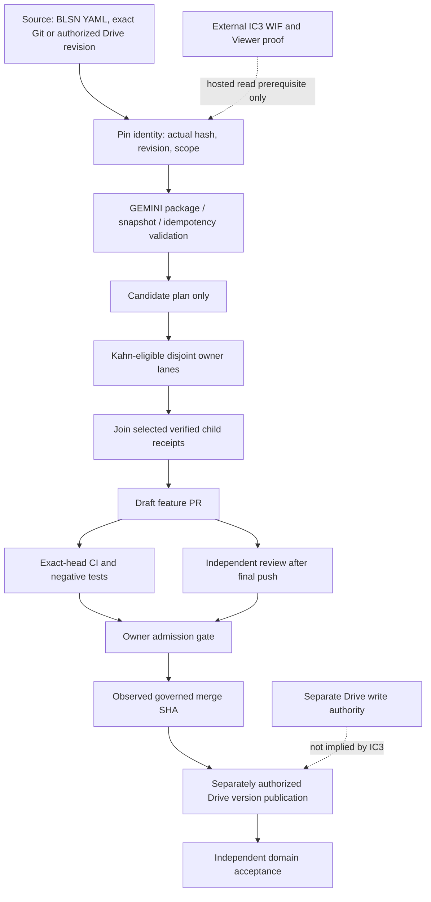
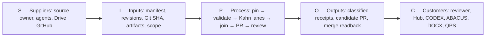
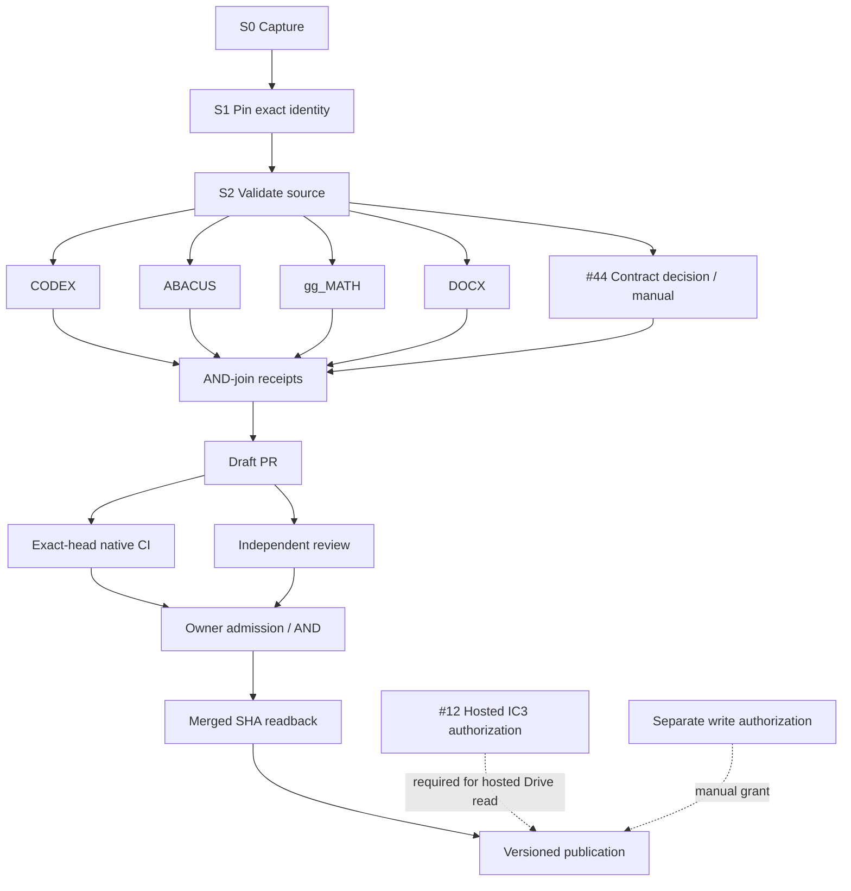
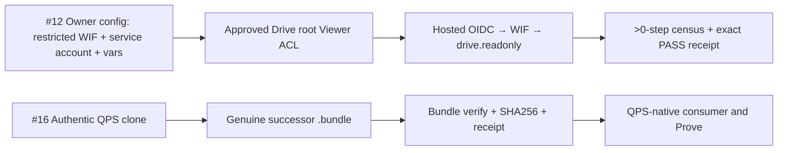

# GEMINI — Governed Source, Analytics and Cross-Agent Handover

[](repo_manifest.yaml)
[](repo_manifest.yaml)
[](https://github.com/GBOGEB/GEMINI/actions/workflows/generate_blsn_reports.yml)
[](.github/workflows/generate_blsn_reports.yml)
[](https://gbogeb.github.io/GEMINI/)
[](LICENSE)

> **GEMINI turns governed configuration and cross-agent work into reproducible, reviewable evidence — without mistaking a proposal, a passed test, a file transfer or a generated graphic for approved engineering truth.**

## At a glance

| | |
|---|---|
| **Domain** | Cross-agent handover (Gemini ⇄ Google Drive ⇄ GitHub) and the BLSN engineering SSOT / validation-and-rendering engine |
| **EPICs carried here** | **GM-I-C** bridge — package, ingress, snapshot, broker ([#12](https://github.com/GBOGEB/GEMINI/issues/12), [#16](https://github.com/GBOGEB/GEMINI/issues/16), [#44](https://github.com/GBOGEB/GEMINI/issues/44)) · **P0-G1** effective `main` protection ([#50](https://github.com/GBOGEB/GEMINI/issues/50)) · **BLSN** SSOT and reports |
| **Owner and decision authority** | Repository owner **GBOGEB**: admission to `main`, the #44 profile choice and every external grant (WIF, Drive ACL, secrets). No agent, bot or CI verdict holds this authority. |
| **Role in the federation** | The *contract and handover surface*: it validates and classifies what agents hand over; it does not schedule, run QA, or accept engineering results. |
| **Owns** | GMI package contract, batch idempotency, evidence binding, read-only Drive census, exact-Git snapshots, the offline proposal broker, BLSN config + renderer |
| **Does not own** | Kahn scheduling and CI census (Hub) · agent runtime (CODEX) · native QA (ABACUS) · numerical methods (gg_MATH) · DOCX/binary QA (DOCX_RTM_Automation) · QPS acceptance (cryoplant-project) |
| **Status snapshot** | `main@737537b`, 13 November 2026 — 4 open issues, 0 open PRs. [Details and closure proofs ↓](#6-status-and-open-gates) |

**New here?** Read [§1](#1-why-gemini-exists--bios) (2 min), then the route that matches you:

| I want to… | Open this first |
|---|---|
| Understand purpose, people, ownership and flow | [BIOS](#1-why-gemini-exists--bios) and [from source to decision](#2-from-source-to-decision) |
| See which module does what | [What is inside](#3-what-is-inside) |
| See the DAG, SIPOC and parallel lanes | [Process diagrams](#5-process-diagrams--flow-sipoc-kahn) and [Kahn validation](docs/bridge/federation/kahn-validation.md) |
| Run the tests myself rather than trust CI badges | [Run it locally](#7-run-it-locally) |
| Hand work in as a Drive-only or Git-capable agent | [Operating routes](#operating-routes), [package contract](docs/bridge/PACKAGE_CONTRACT.md), [proposal broker](docs/bridge/PROPOSAL_BROKER.md) |
| Know what is still open and what would close it | [Status and open gates](#6-status-and-open-gates) |
| Read the full federation specification | [Federation entry point](docs/bridge/federation/README.md), [architecture](docs/bridge/federation/architecture.md) |

## 1. Why GEMINI exists — BIOS

**B — Baseline.** Source-owned configuration is validated as an executable specification before rendering. A generated PDF, chart or dashboard is a view of its YAML/contract source, never a replacement for it.

**I — Identity and integrity.** Every external handover binds an agent session, a provider object/revision or exact Git SHA, the actual digest where bytes are known, an evidence class, the intended scope and the unresolved decisions. A claimed hash is not an observed hash; a Drive revision is not a Git commit.

**O — Orchestration with ownership.** GEMINI contracts, Hub DAG/governance, CODEX planning, ABACUS QA, gg_MATH methods, DOCX generation and QPS acceptance stay separate. Candidate work follows Kahn-style precedence from the Hub; GEMINI does not run a competing scheduler.

**S — Safety and source-qualified status.** Missing prerequisites fail closed. A local PASS does not stand in for hosted authentication, current-head native CI, independent review, effective required checks or owner approval. Private bidder sources and reusable credentials never belong in this public repository.

**Who uses it**

| Reader | Comes for | Leaves with |
|---|---|---|
| External visitor / assessor | Purpose and evidence | This page, [Pages](https://gbogeb.github.io/GEMINI/), live [issues](https://github.com/GBOGEB/GEMINI/issues) |
| Engineer | Change source and prove it | A feature branch, native tests, a draft PR |
| Drive-only AI agent | Return work without GitHub powers | A versioned `GMI-*` proposal the broker can classify |
| Git-capable agent | Return verified code | A Git bundle + SHA receipt, or a draft PR |
| Owner / independent reviewer | Decide admission | An exact-head candidate with CI, review and receipts on the same SHA |

**Where authority lives:** [`repo_manifest.yaml`](repo_manifest.yaml) holds the BLSN BIOS and version; [`config/blsn_config.yaml`](config/blsn_config.yaml) is its configuration substrate; [`GEMINI.md`](GEMINI.md) is the handover governance contract; [`config/federation/governed_broker.v1.json`](config/federation/governed_broker.v1.json) is the inert F02 broker policy. Drive supplies file/revision provenance, GitHub supplies reviewed code identity, and QPS and other domain owners keep their own acceptance authority.

## 2. From source to decision

1. **Find the governing source.** Pick a known Drive object/revision or Git commit; name its owner and permitted scope. Do not go looking for an "authoritative" Drive worktree in unrelated clones.
2. **Prove input identity.** Verify actual bytes, revision, Git object, SHA and path rules. Unsupported claims stay `DECLARED` or `DEFERRED`, never `VERIFIED`.
3. **Validate and plan.** Run GEMINI's package, batch, snapshot or broker validators; classify stale, duplicate, changed, unsafe or conflicting input. An offline plan is **not** branch execution.
4. **Execute only authorized, disjoint lanes.** The Hub provides the scheduling contract. CODEX, ABACUS, gg_MATH and DOCX workers run in parallel only when predecessors, resource locks and access permits are satisfied.
5. **Join committed proof.** Every selected predecessor must deliver a source-bound DoV receipt before a minimal **draft** PR is prepared. A missing or failed child blocks the join.
6. **Admit explicitly.** Native CI on the final PR SHA, meaningful negative tests, an independent review after the last push, and the owner's acceptance of the protection gate. Then read back the merge SHA.
7. **Publish and consume separately.** A *separately authorized* Drive writer may publish a new version and reconcile lineage. Domain consumers — QPS above all — decide independently whether the evidence meets their DoD.

The offline path works today without hosted Google authorization. The **hosted** Drive path stays held until restricted OIDC/WIF, service account, Viewer ACL and a positive census are proven ([#12](https://github.com/GBOGEB/GEMINI/issues/12)). Read-only IC3 never grants Drive write access.

## 3. What is inside

| Block | Native source | Input → output | Boundary |
|---|---|---|---|
| BLSN SSOT + validation | [`config/blsn_config.yaml`](config/blsn_config.yaml), [`src/validators.py`](src/validators.py) | YAML limits → validated configuration | Governing input, not generated output |
| BLSN renderer | [`src/pipeline.py`](src/pipeline.py), [`src/parameters.py`](src/parameters.py) | Validated configuration → reproducible HTML/PDF/visuals | Files are derived views |
| Telemetry and statistics | [`src/telemetry_parser.py`](src/telemetry_parser.py), [`src/stats_engine.py`](src/stats_engine.py), [`src/bt_ranking.py`](src/bt_ranking.py) | CI/historical samples → KPI, DoE, PCA/BT candidates | Inference needs suitable samples and lineage; method owner is gg_MATH |
| Publication | [`src/indexer.py`](src/indexer.py), [`src/jekyll_bridge.py`](src/jekyll_bridge.py), [`docs/index.html`](docs/index.html) | Verified build → index, Pages, artifacts | A published view is not independent authority |
| GMI package and idempotency | [`src/handover_package.py`](src/handover_package.py), [`src/handover_batch.py`](src/handover_batch.py), [`src/handover_binding.py`](src/handover_binding.py) | `GMI-*` manifests → ACCEPT / REJECT / DEFER + receipts | Syntax acceptance ≠ engineering acceptance |
| Drive read-only boundary | [`src/drive_ingress.py`](src/drive_ingress.py), [`src/handover_census.py`](src/handover_census.py) | Authorized hosted read → deterministic census | Hosted proof is [#12](https://github.com/GBOGEB/GEMINI/issues/12) |
| Exact Git ingress/egress | [`src/repo_snapshot.py`](src/repo_snapshot.py), [`src/drive_materialize.py`](src/drive_materialize.py) | Git SHA/bundle → verifiable offline snapshot/worktree | Data ingress never writes a default branch |
| Offline proposal broker | [`src/proposal_broker.py`](src/proposal_broker.py) | Pinned GMI proposal → classified patch/draft plan | No hosted dispatch or unreviewed push; profile choice is [#44](https://github.com/GBOGEB/GEMINI/issues/44) |
| F02 broker policy | [`src/federation_config.py`](src/federation_config.py), [`governed_broker.v1.json`](config/federation/governed_broker.v1.json) | Policy file → validated, **inert** configuration | Grants nothing; see [operations](docs/bridge/federation/operations.md) |
| F05 admission-readiness probe | [`src/federation_admission_probe.py`](src/federation_admission_probe.py) | Exact-head PR evidence → advisory readiness verdict | Always `merge_authorized=false`; see [probe contract](docs/bridge/federation/ADMISSION_READINESS_PROBE_F05.md) |
| Hub schedule adapter | [`src/hub_schedule_handover.py`](src/hub_schedule_handover.py) | Hub UTF-8 plan receipt → GMI `DECLARED` candidate | Hub owns the scheduler and its source protocol |
| R3 successor tooling | [`scripts/build_qps_r3_successor_handoff.ps1`](scripts/build_qps_r3_successor_handoff.ps1), [runbook](docs/R3_SUCCESSOR_INGRESS_RUNBOOK.md) | Authentic QPS Git objects → bundle + sidecar + receipt | Physical bundle is [#16](https://github.com/GBOGEB/GEMINI/issues/16) |
| Cross-repo output bridge | [`src/federation_bridge.py`](src/federation_bridge.py), [`docs/bridge/federation/`](docs/bridge/federation/README.md) | Owner receipts/artifacts → linked review surface | No transfer of source ownership |
| Ecosystem dispatch | [`ecosystem_federated_dispatch.yml`](.github/workflows/ecosystem_federated_dispatch.yml) | SSOT change on `main` → `repository_dispatch` to CODEX and ABACUS | **Not yet live** — see [§6](#6-status-and-open-gates) |

## 4. Where GEMINI sits in the federation

Integrate, do not clone owners. GEMINI links to these repositories; it never re-implements them.

| Repository | Keeps authority for | GEMINI interface |
|---|---|---|
| [pipeline-automation-hub](https://github.com/GBOGEB/pipeline-automation-hub) (`master`) | Mission control, Kahn scheduling, CI/DAG census, merge-governance evidence | Hub schedule receipt → [`hub_schedule_handover.py`](src/hub_schedule_handover.py) |
| [CODEX](https://github.com/GBOGEB/CODEX) | Agent planning, typed contracts, orchestration | Ecosystem dispatch target; GMI proposals |
| [ABACUS](https://github.com/GBOGEB/ABACUS) | Runtime, native QA, first-red diagnosis, negative controls | Ecosystem dispatch target; QA receipts |
| [gg_MATH](https://github.com/GBOGEB/gg_MATH) | Numerical kernels, uncertainty, PCA and Bradley–Terry method | Method source for the statistics block |
| [DOCX_RTM_Automation](https://github.com/GBOGEB/DOCX_RTM_Automation) | DOCX/PDF/HTML rendering, editable-binary QA, publication receipts | Rendering receipts through the output bridge |
| [cryoplant-project](https://github.com/GBOGEB/cryoplant-project) | QPS contract/engineering source and owner-side acceptance | R3 successor bundle ([#16](https://github.com/GBOGEB/GEMINI/issues/16)) |
| [Drive portable worktree](https://drive.google.com/drive/folders/1GMMHGux7x_xgZplqRk0_xEUix7gPJuo-) and [BridgeFlow generic package](https://drive.google.com/drive/folders/1dw2Zy1I-cylXYqGThLRaPJ4HSRhJZV7p) | Source-preserved, portable *candidate* assets | Not a Git remote and not a production dispatcher |

## 5. Process diagrams — flow, SIPOC, Kahn

All diagrams are **declared architecture**, not execution receipts. Solid arrows are finish-to-verified-receipt dependencies, not permission to dispatch; dotted arrows are separate external access gates.

### 5.1 Governing data and control flow



### 5.2 SIPOC — who supplies, processes and consumes evidence



| SIPOC stage | Key check |
|---|---|
| Suppliers / inputs | Who owns the source, can the exact object be read, and is access authorized? |
| Process | Are predecessor receipts, safe paths, gates and resource locks valid? |
| Outputs | Is each object labelled `DECLARED`, `DEFERRED`, `VERIFIED`, `REJECT` or `HOLD` on actual evidence? |
| Customers | Does the receiving owner independently accept the result? |

### 5.3 Kahn dependency DAG — critical series and parallel fan-out



<details>
<summary><b>How to read the Kahn DAG</b> — precedence, parallelism and timing rules</summary>

**Precedence (Kahn).** Check unique node IDs and every predecessor → compute indegree → take the sorted indegree-zero front → remove its outgoing edges → repeat. Nodes left unvisited when the ready set empties mean a cycle; unknown predecessors fail before sorting. A zero-indegree node is *structurally ready* but **not executable** until its source-bound predecessor receipts, manual approvals, access gates and exclusive-resource locks all pass.

**Parallelism.** CODEX, ABACUS, gg_MATH and DOCX are an **illustrative** disjoint front; a real mission selects only the workers it needs, and the join is AND across the *selected* lanes. CI and review may run side by side after the draft PR, but admission needs **both on the same final head**. Same-layer tasks that share a write target are serialized.

**Timing.** With measured durations `d(v)`, longest-path cost is `C(v) = d(v) + max(C(p) for p in predecessors(v))`. Serial steps add; parallel branches contribute their maximum. Without comparable observed durations the critical-path time is **unknown**, not estimated. Rework opens a **new bounded DAG epoch** instead of adding a cycle.

The machine-readable graph has 20 nodes, 24 edges and 11 Kahn layers: [precedence contract](docs/bridge/federation/precedence_contract_v1.json), [test-only Kahn oracle](tests/test_federation_precedence_contract.py), [validation and DoV/DoD](docs/bridge/federation/kahn-validation.md), [Mermaid sources](docs/bridge/federation/diagrams/kahn-lanes.mmd).

</details>

### 5.4 External gates are their own graphs, not code TODOs



IC3 validates **read-only** ingress at the approved root; manual Drive connector access does not prove it. R3 producer capability proofs do not mean the physical Git bundle exists, and QPS consumes it under its own gate. See the [IC3](docs/IC3_EXTERNAL_AUTH_RUNBOOK.md) and [R3](docs/R3_SUCCESSOR_INGRESS_RUNBOOK.md) runbooks.

## 6. Status and open gates

**Snapshot: `main@737537b`, 13 November 2026.** These rows point at live owners; they are **not** self-updating closure badges. Open the linked issue for the current position.

| Gate | Status | What would close it |
|---|---|---|
| [#50](https://github.com/GBOGEB/GEMINI/issues/50) P0-G1 — effective `main` protection | **OPEN** — 3 of 10 DoD criteria met (10 Nov). Ruleset `Main_Protect` (26381197) enforces only deletion and non-fast-forward. | Required checks, independent review and negative canaries enforced by policy and read back; the F05 probe reports readiness but never authorizes |
| [#44](https://github.com/GBOGEB/GEMINI/issues/44) GM-I-C — broker wire-profile collision | **OPEN — owner decision required.** Decision packet P0008 posted 11 Nov; #48 adds fixture/regression evidence only | Explicit owner profile choice, two-format replay, source-bound cross-compatibility DoV |
| [#12](https://github.com/GBOGEB/GEMINI/issues/12) GM-I-C — hosted IC3 | **OPEN — external owner return** | Restricted WIF, dedicated service account, approved-folder Viewer, vars and a real `IC3_DRIVE_READONLY_GT0_STEP_PASS` |
| [#16](https://github.com/GBOGEB/GEMINI/issues/16) GM-I-C — QPS R3 successor | **OPEN — physical return** | Genuine exact-Git bundle triplet from an authentic clone; QPS downstream re-proof is separate |
| [#53](https://github.com/GBOGEB/GEMINI/pull/53) ecosystem dispatch | **MERGED, not live.** No run recorded; no repository secret is listed, so `ECOSYSTEM_PAT` is absent. Two of its three trigger paths (`config/worktree_manifest.yaml`, `notebook/blsn_interactive.md`) do not exist on `main`. | Owner adds a scoped `ECOSYSTEM_PAT`; trigger paths reconciled with real files; CODEX and ABACUS receivers declared; one observed delivery |
| [#48](https://github.com/GBOGEB/GEMINI/pull/48) F02 policy + F05 probe | **MERGED** at `fec1ded` | Inert by design: it changes no protection and grants no admission |

A green PR job or a completed merge is **not** proof of a configured admission policy while #50 is open.

## 7. Run it locally

The only gating CI leg is **Python 3.9 on ubuntu-24.04**; every other matrix leg (3.10–3.12, 3.13/3.14-dev, PyPy, other OSes) runs its tests with `continue-on-error`, so it is advisory. Test on 3.9 before calling a change verified.

```bash
git clone https://github.com/GBOGEB/GEMINI.git
cd GEMINI
python -m pip install pytest pyyaml fpdf2 plotly pandas
python -m pytest -q tests/test_readme_landing.py tests/test_federation_precedence_contract.py
python -m pytest -q tests
python -m src.pipeline
```

Local runs are a development path, not native CI. Exact-head evidence lives in the [BLSN workflow](.github/workflows/generate_blsn_reports.yml) and the focused [ingress](.github/workflows/drive_ingress_tests.yml), [GMI](.github/workflows/gmi_handover_tests.yml), [broker](.github/workflows/proposal_broker_tests.yml) and [federation policy](.github/workflows/federation_config_tests.yml) jobs. The precedence fixture is a **structural test only**: it dispatches no agents, does no Drive I/O and approves nothing.

### Operating routes

| Starting capability | Allowed route | Not implied |
|---|---|---|
| Drive-only agent | `GMI-*` package → offline broker patch/draft plan | GitHub push or merge |
| Git-capable agent without GitHub authorization | Verified Git bundle + SHA/receipt via `LANES/<lane>/OUT` ([lanes](docs/bridge/LANES.md)) | A granted GitHub token |
| Authorized Git developer | Scoped feature branch → draft PR → native CI and review | Default-branch admission |
| Hosted Drive reader | Restricted GitHub OIDC → Google WIF → Drive Viewer → read-only census | Drive write permission |
| Report consumer | Published report / CI artifact + source receipt | Engineering or contractual acceptance |

## 8. Evidence rules and non-compensation

Navigation priority is source → validator → real execution receipt → independent review → derived output. Source assertions use `VERIFIED`, `IMPLEMENTED`, `DECLARED`, `INFERRED`, `PARTIAL` or `DEFERRED` per [GEMINI.md](GEMINI.md). Workflow verdicts (ACCEPT / REJECT / DEFER), GitHub check conclusions, owner approval and engineering dispositions are **separate fields**; one never fills in for another.

- A matching digest verifies bytes under a named canonicalization contract — not author identity or authorization.
- A green synthetic test is not a hosted WIF/Drive proof, a meaningful security canary, or an approved merge.
- A merge into `main` does not retroactively prove that incompatible wire contracts were reconciled.
- QPS procurement, contract and engineering decisions stay source-owned in cryoplant-project; nothing in this public repository grants them.
- Never commit private handover contents, tokens, Google service-account keys or bidder data, and never widen Drive access silently.

## 9. Repository map and next actions

| Source | Why open it |
|---|---|
| [`repo_manifest.yaml`](repo_manifest.yaml), [`GEMINI.md`](GEMINI.md) | BIOS version, authority and evidence controls |
| [`config/`](config/), [`src/`](src/), [`tests/`](tests/) | Configuration, code owners, native tests |
| [`docs/bridge/`](docs/bridge/) | GMI package, Drive, snapshot and proposal contracts |
| [`docs/bridge/federation/`](docs/bridge/federation/README.md) | Federation architecture, auth separation, diagrams, BD queue, F02 operations, F05 probe |
| [`docs/landing/LANDING_SKELETON.md`](docs/landing/LANDING_SKELETON.md) | The shared structure of this page and how to personalize it for another repository |
| [`docs/index.html`](docs/index.html), [Pages](https://gbogeb.github.io/GEMINI/) | Generated BLSN review artifacts — not source authority |
| [`docs/wave_16_plan.md`](docs/wave_16_plan.md) | Historical proposal; reconcile with code before treating it as implemented |
| [Issues](https://github.com/GBOGEB/GEMINI/issues), [pull requests](https://github.com/GBOGEB/GEMINI/pulls), [Actions](https://github.com/GBOGEB/GEMINI/actions) | Live TODO, actual PR heads, CI and admission evidence |

**Next governed actions, in order:**

1. Owner decides the **#44** profile choice (packet P0008 is waiting).
2. Close the **#50** protection gap: required checks and review enforced by ruleset, then read back.
3. Make **#53** dispatch either live (scoped secret, real trigger paths, declared receivers) or explicitly parked.
4. Obtain the **#12** external authorization return and the **#16** physical Git bundle.
5. Re-cut the [status snapshot](#6-status-and-open-gates) at the new `main` SHA whenever one of these moves.

Use a new branch and an independent review for every change; never push to protected `main` as an agentic shortcut.

---

**BIOS:** governed SSOT validation/rendering + source-pinned cross-agent handover. **Release authority:** no automatic transfer. **Source licence:** [MIT](LICENSE). **Landing:** R2 of the [shared skeleton](docs/landing/LANDING_SKELETON.md), cut at `main@737537b` on 2026-11-13 (R1: [#49](https://github.com/GBOGEB/GEMINI/pull/49)).
