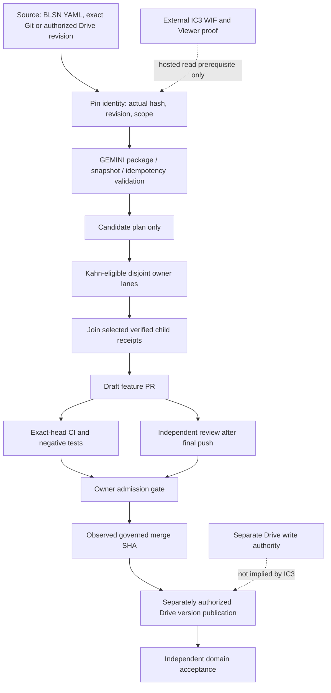
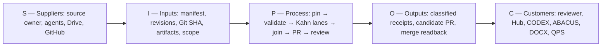
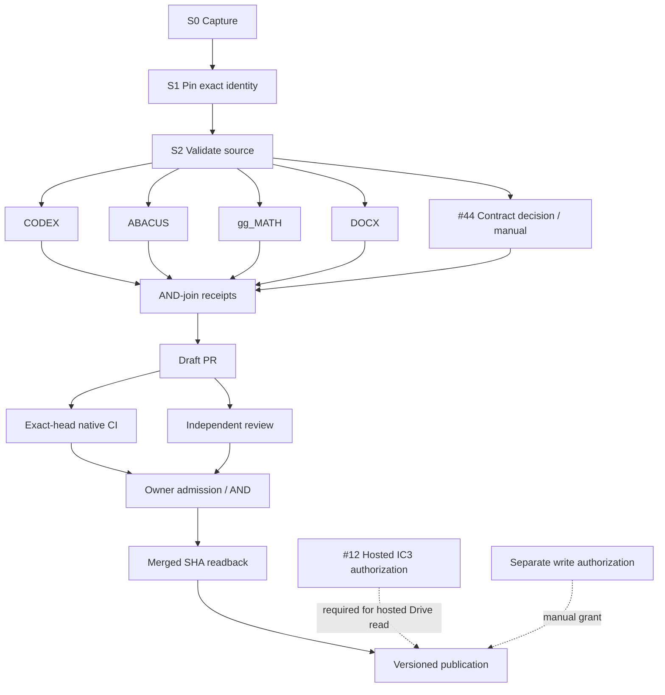
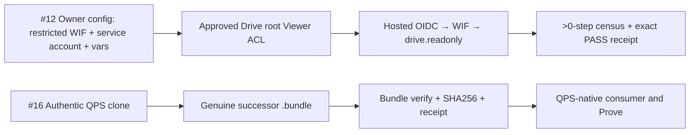

# GEMINI — Governed Source, Analytics and Cross-Agent Handover

[](repo_manifest.yaml)
[](repo_manifest.yaml)
[](https://github.com/GBOGEB/GEMINI/actions/workflows/generate_blsn_reports.yml)
[](https://gbogeb.github.io/GEMINI/)
[](LICENSE)

> **GEMINI exists to turn governed configuration and cross-agent work into reproducible, reviewable evidence — without confusing a proposal, a passed test, a file transfer or a generated graphic with approved engineering truth.**

**Public START HERE · architecture and source navigation · 10 November 2026.** GEMINI has two connected purposes: a BLSN engineering SSOT/validation-and-rendering engine, and a constrained Gemini/Google Drive/GitHub handover contract that allows otherwise disconnected coding agents to exchange **source-pinned candidates**. It does **not** itself provide autonomous access to Drive, cross-repository merge authority or QPS acceptance.

| I want to… | Open this first |
|---|---|
| Understand purpose, people, ownership and flow | [BIOS and reader journey](#1-why-this-repository-exists--bios) |
| Understand the actual functions, inputs and outputs | [Capability map](#3-primary-functions-and-source-owners) |
| See the dependency DAG, SIPOC and parallel lanes | [Process diagrams](#4-system-dag-and-sipoc) and [Kahn validation](docs/bridge/federation/kahn-validation.md) |
| Run local source/QA rather than infer CI | [Quick start](#7-local-first-steps-and-tests) |
| Integrate a Drive-only or Git-capable agent | [Bridge contracts](docs/bridge/PACKAGE_CONTRACT.md) and [proposer routes](docs/bridge/PROPOSAL_BROKER.md) |
| Inspect current gates and unfinished work | [Live issue links and proof boundaries](#8-evidence-governance-and-current-frontier) |
| Review the complete federation specification | [Federation entry point](docs/bridge/federation/README.md), [architecture](docs/bridge/federation/architecture.md) |

## 1. Why this repository exists — BIOS

**B — Baseline.** Source-owned configuration is validated as an executable specification before rendering; a generated PDF, chart or dashboard is a view, not a replacement for its YAML/contract source.

**I — Identity and integrity.** Every external handover binds an agent session, provider object/revision or exact Git SHA, actual digest where bytes are known, evidence class, intended scope and unresolved decisions. A claimed hash is not an observed hash; a Drive revision is not a Git commit.

**O — Orchestration with ownership.** The federation separates GEMINI contracts, Hub DAG/governance, CODEX code planning, ABACUS native QA, gg_MATH methods, DOCX/binary generation and QPS engineering acceptance. It uses Kahn-style precedence for candidate work, not a new competing universal scheduler.

**S — Safety and source-qualified status.** Missing prerequisites fail closed. A local PASS does not substitute for hosted authentication, current-head native CI, independent review, effective required checks or owner approval. No private bidder source or reusable credentials belong in this public repository.

**Who uses it?** A reader assesses purpose and evidence; an engineer edits source and verifies native tests; a Drive-only AI agent returns a versioned `GMI-*` proposal without GitHub write powers; a Git-capable agent returns a verified bundle or PR; an independent owner/reviewer decides whether an exact-head candidate may enter governed history.

**Where authority lives:** [`repo_manifest.yaml`](repo_manifest.yaml) defines the BLSN BIOS and version; [`config/blsn_config.yaml`](config/blsn_config.yaml) is its configuration substrate; [`GEMINI.md`](GEMINI.md) is the handover governance contract. Drive supplies file/revision provenance. GitHub supplies reviewed code identities. QPS and other domain owners retain their own acceptance authority.

## 2. Reader journey — what happens from source to decision

1. **Find the governing source.** Select a known Drive object/revision or Git commit, identify source owner and permitted scope. Do not search for an authoritative Drive worktree in unrelated GitHub or local clones.
2. **Prove input identity.** Verify actual bytes, revision, Git object, SHA and path constraints. Mark unsupported claims as `DECLARED` or `DEFERRED`, not `VERIFIED`.
3. **Validate and plan.** Run GEMINI's existing package, batch, snapshot or broker validators; classify stale, duplicate, changed, unsafe or conflicting inputs. Offline plan generation is **not** branch execution.
4. **Execute only authorized disjoint lanes.** Hub/BridgeFlow provide the scheduling contract. Scoped CODEX, ABACUS, gg_MATH and DOCX workers can progress concurrently only when predecessors, resource locks and access permits are satisfied.
5. **Join committed proof.** Require every selected predecessor's source-bound DoV receipt; then prepare a minimal **draft** GitHub PR. Failed or absent child evidence blocks the join.
6. **Admit explicitly.** Native CI must run on the final PR SHA, meaningful negative tests must pass, independent review must be current, and the authorized owner must accept the effective protection gate. Read back the resulting merge SHA.
7. **Publish and consume separately.** A *separately authorized* Drive writer may publish a new version, verify readback and reconcile lineage. Domain consumers (especially QPS) independently decide whether the evidence meets their DoD.

The offline path can prepare candidates without hosted Google authorization. The **hosted** Drive path cannot proceed until its restricted OIDC/WIF, service-account, Viewer ACL and positive census evidence are proven. Read-only IC3 does **not** grant Drive write access.

## 3. Primary functions and source owners

| Block | Native GEMINI source | Input → output | Boundary |
|---|---|---|---|
| BLSN SSOT + validation | [`config/blsn_config.yaml`](config/blsn_config.yaml), [`src/validators.py`](src/validators.py) | YAML limits → validated configuration | Governing input, not generated output |
| BLSN renderer | [`src/pipeline.py`](src/pipeline.py), [`src/parameters.py`](src/parameters.py) | Validated configuration → reproducible HTML/PDF/visuals | Files are derived views |
| Telemetry and statistics | [`src/telemetry_parser.py`](src/telemetry_parser.py), [`src/stats_engine.py`](src/stats_engine.py), [`src/bt_ranking.py`](src/bt_ranking.py) | CI/historical samples → KPI, DoE, PCA/BT candidates | Statistical inference needs suitable samples and source lineage |
| Publication/readers | [`src/indexer.py`](src/indexer.py), [`src/jekyll_bridge.py`](src/jekyll_bridge.py), [`docs/index.html`](docs/index.html) | Verified build → index, Pages and artifacts | Published view is not independent authority |
| GMI package and idempotency | [`src/handover_package.py`](src/handover_package.py), [`src/handover_batch.py`](src/handover_batch.py), [`src/handover_binding.py`](src/handover_binding.py) | `GMI-*` manifests → ACCEPT/REJECT/DEFER, receipts | Syntax acceptance ≠ engineering acceptance |
| Drive read-only boundary | [`src/drive_ingress.py`](src/drive_ingress.py), [`src/handover_census.py`](src/handover_census.py) | Authorized hosted read → deterministic census | [IC3 #12](https://github.com/GBOGEB/GEMINI/issues/12) is separate external proof |
| Exact Git ingress/egress | [`src/repo_snapshot.py`](src/repo_snapshot.py), [`src/drive_materialize.py`](src/drive_materialize.py) | Git SHA/bundle → verifiable offline snapshot/worktree | No default-branch write by data ingress |
| Offline proposal broker | [`src/proposal_broker.py`](src/proposal_broker.py) | Pinned GMI proposal → classified patch/draft plan | No hosted dispatch or unreviewed push; [#44](https://github.com/GBOGEB/GEMINI/issues/44) still owns cross-format policy |
| Hub schedule adapter | [`src/hub_schedule_handover.py`](src/hub_schedule_handover.py) | Hub canonical UTF-8 plan receipt → GMI `DECLARED` candidate | Hub owns Kahn scheduler; [Hub #1138](https://github.com/GBOGEB/pipeline-automation-hub/pull/1138) owns source protocol |
| R3 successor tooling | [`scripts/build_qps_r3_successor_handoff.ps1`](scripts/build_qps_r3_successor_handoff.ps1), [runbook](docs/R3_SUCCESSOR_INGRESS_RUNBOOK.md) | Authentic QPS Git objects → verified bundle/sidecar/receipt | Physical bundle [#16](https://github.com/GBOGEB/GEMINI/issues/16) is an independent return |
| Cross-repo output bridge | [`src/federation_bridge.py`](src/federation_bridge.py), [`docs/bridge/federation/`](docs/bridge/federation/README.md) | Owner receipts/artifacts → linked review surface | No transfer of source ownership |

### Federation: integrate, do not clone owners

| Existing repo | Retained authority / GEMINI interface |
|---|---|
| [pipeline-automation-hub](https://github.com/GBOGEB/pipeline-automation-hub) (`master`) | Mission control, Kahn scheduling, CI/DAG census and merge-governance evidence |
| [CODEX](https://github.com/GBOGEB/CODEX) | Agent planning, typed contracts, orchestration integration |
| [ABACUS](https://github.com/GBOGEB/ABACUS) | Runtime, native QA, first-red diagnosis, negative controls |
| [gg_MATH](https://github.com/GBOGEB/gg_MATH) | Governed numerical kernels, uncertainty, PCA and Bradley–Terry methodology |
| [DOCX_RTM_Automation](https://github.com/GBOGEB/DOCX_RTM_Automation) | DOCX/PDF/HTML rendering, editable-binary QA and publication receipts |
| [cryoplant-project](https://github.com/GBOGEB/cryoplant-project) | QPS contract/engineering source and owner-side acceptance |
| [Google Drive portable BridgeFlow worktree](https://drive.google.com/drive/folders/1dw2Zy1I-cylXYqGThLRaPJ4HSRhJZV7p) | Source-preserved, portable *candidate* worktree, not a Git remote or production dispatcher |

## 4. System DAG and SIPOC

### 4.1 Governing data/control flow



Solid arrows are **finish-to-verified-receipt dependencies**, not permission to dispatch. Dotted prerequisites mark distinct external access gates. The diagram depicts the intended full route: published/hosted steps remain **held** unless separately qualified.

### 4.2 SIPOC — who supplies, processes and consumes evidence



| SIPOC stage | Key check |
|---|---|
| Suppliers / inputs | Who owns the source, can the exact object be read, and has access been authorized? |
| Process | Are predecessor receipts, safe paths, gates and resource locks valid? |
| Outputs | Is each object labelled `DECLARED`, `DEFERRED`, `VERIFIED`, `REJECT` or `HOLD` on actual evidence? |
| Customers | Does the receiving owner independently accept the result? |

### 4.3 Kahn dependency DAG — critical series and disjoint parallel fan-out



**Precedence validation (Kahn):** validate unique node IDs and every predecessor → compute indegree → take the sorted indegree-zero front → remove its outgoing edges → repeat. Unvisited nodes after the ready set empties indicate a cycle or invalid graph; unknown predecessors fail before sorting. A zero-indegree node is *structurally ready*, but **not executable** unless all source-bound predecessor receipts, manual approvals, access gates and exclusive-resource locks also pass.

**Parallelism:** CODEX, ABACUS, gg_MATH and DOCX form an **illustrative** disjoint front; each real mission selects only applicable workers. The join is AND across all *selected* lanes. Review and CI can run alongside each other after the draft PR, but admission requires **both on the same final head**. Same-layer tasks sharing a write target must be serialized.

**Timing:** with measured durations `d(v)`, longest-path cost is `C(v) = d(v) + max(C(p) for p in predecessors(v))`. The serial path adds durations; parallel branches contribute their maximum. Without comparable observed durations, critical-path time is **unknown**, not fabricated. Any recursive rework starts a **new bounded DAG epoch** rather than adding a cycle.

Read [the full machine-readable graph](docs/bridge/federation/precedence_contract_v1.json), [test-only Kahn oracle](tests/test_federation_precedence_contract.py), [validation and DoV/DoD](docs/bridge/federation/kahn-validation.md) and [Mermaid source diagrams](docs/bridge/federation/diagrams/kahn-lanes.mmd).

## 5. External gates are separate graphs, not ordinary code TODOs



IC3 validates **read-only** ingress at the approved root; it cannot be inferred from manual Drive connector access. R3 producer capability/capsule proofs do not imply the physical Git bundle exists, and QPS consumes it under an independent gate. See [IC3](docs/IC3_EXTERNAL_AUTH_RUNBOOK.md) and [R3](docs/R3_SUCCESSOR_INGRESS_RUNBOOK.md).

## 6. Source of truth, evidence vocabulary and non-compensation

Source → validator → real execution receipt → independent review → derived output is the navigation priority. Recorded source assertions use `VERIFIED`, `IMPLEMENTED`, `DECLARED`, `INFERRED`, `PARTIAL` or `DEFERRED` per [GEMINI.md](GEMINI.md); workflow verdicts (ACCEPT/REJECT/DEFER), GitHub check conclusions, owner approval and engineering dispositions are **different fields**.

- A matching digest verifies bytes under a named canonicalization contract, not author identity or authorization.
- A green synthetic test is not a hosted WIF/Drive proof, a meaningful security negative canary, or an independently approved merge.
- A PR merged into `main` does not retroactively prove incompatible wire contracts were reconciled.
- QPS procurement/contract/engineering decisions remain source-owned in cryoplant-project; no output from this public repo can grant them.
- Never put private handover contents, tokens, Google service-account keys or bidder data in the public Git repository; never silently widen Drive access.

## 7. Local first steps and tests

```bash
git clone https://github.com/GBOGEB/GEMINI.git
cd GEMINI
python -m pip install pytest pyyaml fpdf2 plotly pandas
python -m pytest -q tests/test_federation_precedence_contract.py
python -m pytest -q tests
python -m src.pipeline
```

The sample tests are a **local development path**, not a claim that every host has matched the repository's native CI environment. Use the [BLSN workflow](.github/workflows/generate_blsn_reports.yml) and focused [ingress](.github/workflows/drive_ingress_tests.yml), [GMI](.github/workflows/gmi_handover_tests.yml) and [broker](.github/workflows/proposal_broker_tests.yml) jobs to inspect real, exact-head evidence. The new precedence fixture is a **structural test only**; it dispatches no agents, performs no Drive I/O and grants no PR approval.

### Operating routes

| Starting capability | Allowed route | Not implied |
|---|---|---|
| Drive-only agent | `GMI-*` package → offline broker patch/draft plan | GitHub push/merge |
| Git-capable agent without GitHub authorization | Verified Git bundle + SHA/receipt via `LANES/<lane>/OUT` | A granted GitHub token |
| Authorized Git developer | Scoped feature branch → draft PR → native CI and review | Default-branch admission |
| Hosted Drive reader | Restricted GitHub OIDC → Google WIF → Drive Viewer → read-only census | Drive write permission |
| Report consumer | Published report / CI artifact + source receipt | Engineering or contractual acceptance |

## 8. Evidence governance and current frontier

**Status snapshot — 10 November 2026.** These are pointers to live source owners, **not live-updating badges of closure**.

| Boundary | Status | Closure proof required |
|---|---|---|
| [#44](https://github.com/GBOGEB/GEMINI/issues/44) — broker wire collision | **OPEN**; #40/#41 merged, [#46](https://github.com/GBOGEB/GEMINI/pull/46) adds a fail-closed negative guard | Explicit owner profile decision, two-format replay and source-bound cross-compatibility DoV |
| [#12](https://github.com/GBOGEB/GEMINI/issues/12) — hosted IC3 | **OPEN / external owner return** | Restricted WIF, dedicated service account, approved-folder Viewer, vars and real `IC3_DRIVE_READONLY_GT0_STEP_PASS` |
| [#16](https://github.com/GBOGEB/GEMINI/issues/16) — QPS R3 successor | **OPEN / physical return** | Genuine exact-Git bundle triplet from authentic clone; QPS downstream reproof separate |
| [#45](https://github.com/GBOGEB/GEMINI/pull/45) — Hub UTF-8 receipt | **MERGED candidate adapter** | Does not make Hub schedule execution or IC3 true |
| [#47](https://github.com/GBOGEB/GEMINI/pull/47) — Windows patch notes | **MERGED doc repair** | Does not prove hosted dispatch or policy |

The active `Main_Protect` ruleset was observed to cover deletion and non-fast-forward updates. **Effective required-check and independent-review enforcement have not been proven by that ruleset alone.** Do not interpret a successful PR job or an actual merge as proof of a fully configured admission policy.

## 9. Repository map and governed next actions

| Source | Why open it |
|---|---|
| [`repo_manifest.yaml`](repo_manifest.yaml), [`GEMINI.md`](GEMINI.md) | BIOS version, authority/evidence controls |
| [`config/`](config/), [`src/`](src/), [`tests/`](tests/) | Config, code owners and native tests |
| [`docs/bridge/`](docs/bridge/) | GMI package, Drive, snapshots and proposal contracts |
| [`docs/bridge/federation/`](docs/bridge/federation/README.md) | Federation architecture, auth separation, diagrams, BD queue |
| [Kahn contract and traceable test](docs/bridge/federation/kahn-validation.md) | Precedence verification, expected fronts, external gates and DoV |
| [`docs/index.html`](docs/index.html), [Pages](https://gbogeb.github.io/GEMINI/) | Generated BLSN review artifacts, not source authority |
| [`docs/wave_16_plan.md`](docs/wave_16_plan.md) | Historical proposal; reconcile with code before treating it as implemented |
| [Issues](https://github.com/GBOGEB/GEMINI/issues), [pull requests](https://github.com/GBOGEB/GEMINI/pulls), [Actions](https://github.com/GBOGEB/GEMINI/actions) | Live TODO, actual PR heads, CI and admission evidence |

The next governed work is to resolve the **#44 profile choice**, obtain the **#12 external authorization return** and the **#16 physical Git bundle**, and keep this public narrative synchronized with the root manifest, proof receipts and rendered outputs. Use new branches and independent reviews for changes; never push to protected `main` as an agentic shortcut.

---

**BIOS:** governed SSOT validation/rendering + source-pinned cross-agent handover. **Release authority:** no automatic transfer. **Source license:** [MIT](LICENSE). **Public reader update proposed:** 2026-11-10.
