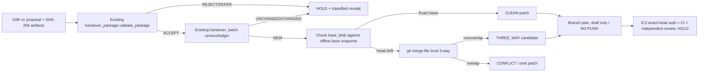

# GM-I-C R2-W2 — offline GMI proposal-ingest broker (IC7/IC8 candidate)

**Owner:** `GBOGEB/GEMINI` · **state:** offline dry-run code, draft PR / no admission · **Wave:** R2-W2 · **source:** governed Drive handover (`FEDERATED_DAG_BRIDGE_GENERIC_v0.1.0_20261108`).

This is the **proposal** direction of the existing two-way bridge, *not a second Drive client or new worktree owner*. It reuses `src/handover_package.py` for the GMI package contract and `src/handover_batch.py` for batch idempotency. It does not change `src/drive_ingress.py`, `src/drive_materialize.py`, `src/repo_snapshot.py`, or the `GM-I-C` control baseline. No broker credentials or hosted dispatch are introduced. The Hub remains the control/observability owner.

## Existing GMI package profile — not a new schema

Use an ordinary `GMI-*/MANIFEST/manifest.yaml` with all required GMI v1 fields. Add this extension key:

```yaml
proposal_profile:
  schema: gmi.proposal_profile.v1
  repository: GBOGEB/GEMINI
  base_sha: "1111111111111111111111111111111111111111" # replace with exact, independently verified SHA
  head_sha: "2222222222222222222222222222222222222222" # replace with exact, independently verified SHA
  changes:
    - op: modify
      path: docs/report.txt
      artifact_path: ARTIFACTS/replacement.txt
      base_blob: "aaaaaaaaaaaaaaaaaaaaaaaaaaaaaaaaaaaaaaaa" # git blob OID of base version
```

Also list `ARTIFACTS/replacement.txt` as a **required local_file** in normal `artifact_refs`, with its measured SHA-256. The broker verifies it through the original GMI validator. `base_blob` is **Git SHA-1 blob OID** of the file at the declared base commit, not a SHA-256, and is checked against the local base snapshot. The snapshot's **commit identity itself is not proven** by these local file checks. The declared `base_sha` and `head_sha` are labels until the existing R2-W1 exact-SHA snapshot verifier attests them. Do not treat them as verified base/head refs from client input.

Only bounded UTF-8 **modify** proposals are supported in W2. New, delete, rename, binary, symlink, credential path, undeclared artifact, duplicate target, large data and untrusted adapters are held for follow-up review. A file-level collision or Git `merge-file` conflict never silently becomes a patch.

## Offline CLI (no network, no GitHub writes)

```powershell
python -m src.proposal_broker `
  --package "C:\handover\inbox\GMI-001" `
  --base-root "C:\snapshots\verified-base" `
  --head-root "C:\snapshots\verified-head" `
  --repo "GBOGEB/GEMINI" `
  --ledger-in "C:\handover\prior_ledger.json" `
  --output "C:\handover\broker-dry-run.json"
```

`--ledger-in` is optional. Nothing writes a ledger by default: `updated_ledger_candidate` is proposed only, and must **not** be persisted without owner control after a conflict, stale or rejected package. Inputs are never mutated; `git merge-file --stdout` is the only invoked subprocess, only for local text three-way simulation.

| Disposition | Meaning | Execution gate |
|---|---|---|
| `CLEAN` | Current head blob equals declared base blob; isolated patch generated | Only candidate; commit SHA and CI still gated |
| `THREE_WAY` | Base drifted, local `git merge-file` completed without conflicts | Requires owner review of merged diff; no branch pushed |
| `CONFLICT` | File-level text merge conflict | Patch omitted; manual resolution required |
| `NOOP` | Proposed content equals current head | No patch/commit needed |
| `NOOP_DUPLICATE` | Existing GMI ledger already saw the identical session manifest | No patch/commit needed; no ledger mutation |
| `HOLD` | GMI reject/defer, bad base blob, unsafe path, conflicting session or missing tool | No branch plan, no patch |

`branch_plan.draft_pr_only=true` and `dispatch_disabled=true` are **not** authorization to open a PR from Drive proposals. That later step requires IC3 hosted external identity, exact-SHA binding, a least-privilege GitHub App and separate owner approval. This W2 code is a dry-run plan provider, not that app.

## DAG, lane matrix and gates



| Lane | W1 predecessor | W2 now | W3 owner-gated | W4+ future |
|---|---|---|---|---|
| Drive ingress | `src/drive_ingress.py` | Pure local `GMI-*` package only | WIF/ACL | Hosted read |
| Snapshot | `src/repo_snapshot.py` | Inputs declared, **not attested** | Offline verifier needed | Hosted publish |
| Proposal | Existing GMI package | Validate + base-blob + patch/branch plan | Broker auth setup | Draft PR dispatch |
| Ledger | Existing `handover_batch.py` | Reuse; no mutation | Source receipts | Drive return receipt |
| Control/QA | R2-W0 Hub #1135 | Local positive/negative pytest + exact-head CI | Gate owner | Admission proof |

## Executed tests versus production claims

- Unit tests cover clean/no-op/three-way/conflict, Git blob OID parity with `git hash-object`, idempotency new/unchanged/changed/duplicate, GMI integrity and deferred evidence, malicious paths, binary and large content, prompt-as-data, multi-change partial-patch refusal, and no repo mutation.
- The broker has **no browser, Drive, GitHub, external worker, branch or main write**.
- Its P1 draft PR is **not** P2 exact-head CI nor P3 merge. Even a successful local unit test cannot burn `IC3_AUTH` and does not claim QPS engineering authority.
- The generic BridgeFlow Python worktree remains canonical **in Drive**, not copied in full into GEMINI. This adapter consumes proposed GMI artifacts, not code copied from the scheduler.

## Related sources

- `GBOGEB/GEMINI#38` (R2-W1 exact-SHA offline snapshot), `GBOGEB/pipeline-automation-hub#1135` (R2-W0 control).
- `GBOGEB/GEMINI#12` (IC3 WIF identity; owner only).
- `docs/bridge/PACKAGE_CONTRACT.md`, `docs/bridge/BATCH_IDEMPOTENCY.md`, `docs/bridge/LANES.md` (R3 lane OUT return).
- Google Drive: `https://drive.google.com/drive/folders/1dw2Zy1I-cylXYqGThLRaPJ4HSRhJZV7p`.
