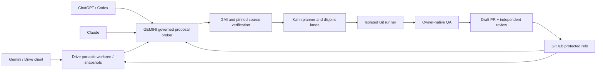
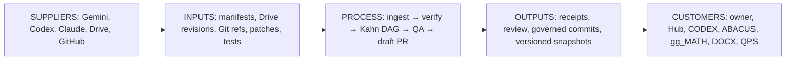
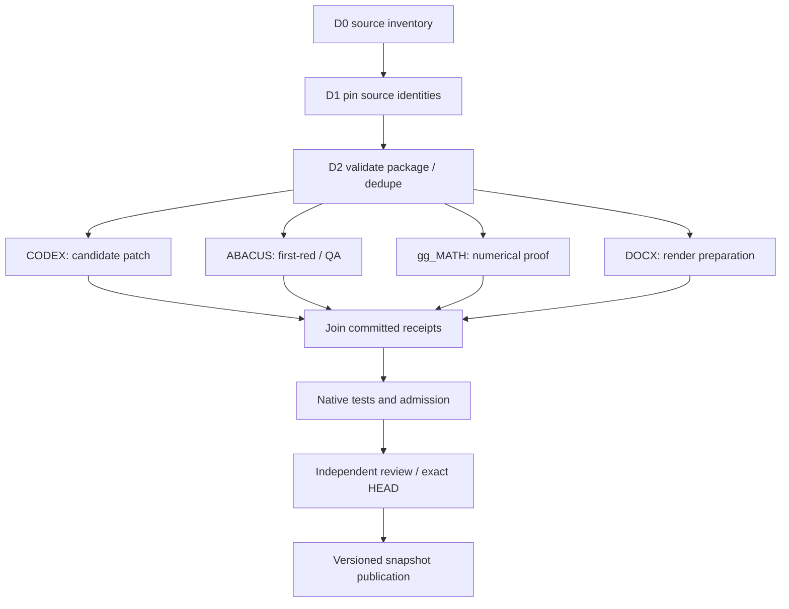
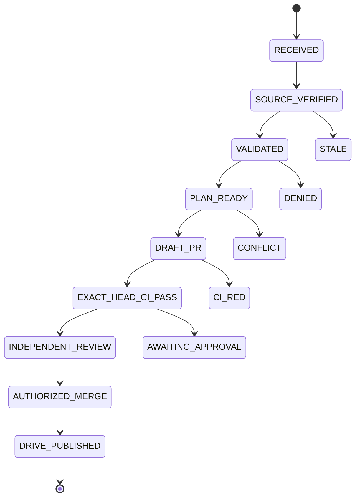

# Federation diagrams — GitHub-native Mermaid preview

**Source:** GBOGEB/GEMINI main at cf72ec33ff85017c997d51bc563e5708453212a1.
**Visibility:** GitHub renders these fenced Mermaid blocks from the exact repository sources; this is a Markdown preview, not proof of a pinned Mermaid CLI export.
**External static review:** a six-page Graphviz semantic fallback PDF, offline SVG/HTML, and SHA-256 manifest were generated and visually inspected separately. Native Mermaid CLI parity remains an open BD-08 QA gate.

Do not interpret these graphs as evidence that GitHub App, Google WIF, native merge review, or hosted bidirectional publication is operational.

## topology

Source blob Git OID: `0d32e106da6c370da230a1da745e97e77e2e8b4f` · [Editable .mmd](topology.mmd)



## sipoc

Source blob Git OID: `4a8a032870cb5930cf8ef366d331d7a3aa7361b2` · [Editable .mmd](sipoc.mmd)



## kahn-lanes

Source blob Git OID: `002cbc0e90b7f073c46073bbf653c749b29db0f4` · [Editable .mmd](kahn-lanes.mmd)



## roundtrip-sequence

Source blob Git OID: `84182ff2e291fbf35ef55fc213aa1ae1b45ae4db` · [Editable .mmd](roundtrip-sequence.mmd)

```mermaid
sequenceDiagram
    participant Agent as Gemini/Codex/Claude
    participant Drive as Google Drive
    participant Broker as GEMINI Broker
    participant GH as GitHub
    participant QA as Native CI / Reviewer
    Agent->>Drive: Write versioned GMI proposal
    Broker->>Drive: Authorized revision read
    Drive-->>Broker: Bytes and object identity
    Broker->>GH: Verify pinned refs
    GH-->>Broker: Exact Git objects
    alt Stale or conflicting
      Broker-->>Drive: HOLD receipt; preserve original
    else Valid and authorized
      Broker->>GH: Isolated branch and draft PR
      GH->>QA: Exact head checks and review
      QA-->>GH: Approval if gates pass
      GH-->>Broker: Observed authorized merge SHA
      Broker->>Drive: Publish new immutable snapshot
      Drive-->>Broker: Readback and revision
    end
```

## admission-state

Source blob Git OID: `15d22501e4796b4a071bea920309508e8de01d13` · [Editable .mmd](admission-state.mmd)



