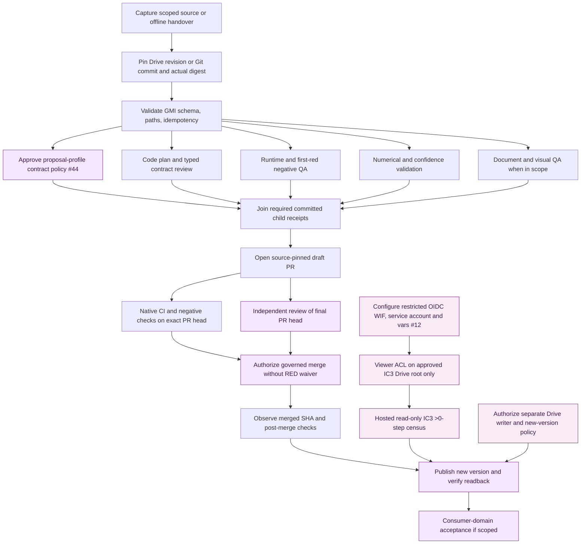
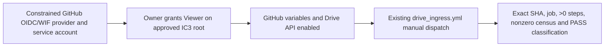
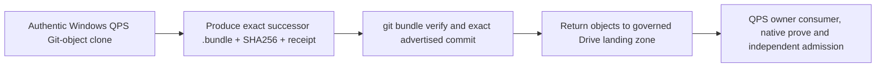

# GEMINI federation — DAG, Kahn sequence validation and proof gates

**Contract:** `gmi.federation_precedence.v1` · **snapshot:** 2026-11-10 · **state:** DECLARED ARCHITECTURE · **owner of real scheduling:** `GBOGEB/pipeline-automation-hub`, with Drive BridgeFlow candidate adapters. This document plus the JSON fixture **does not** implement or authorize a production scheduler, a GitHub App, automatic merge or Drive writing.

Navigation: [public README](../../../README.md) · [machine-readable DAG](precedence_contract_v1.json) · [structural tests](../../../tests/test_federation_precedence_contract.py) · [federation overview](README.md) · [Mermaid graph](diagrams/kahn-lanes.mmd).

## 1. Identity before precedence

A dependency is valid only after the owner source, typed contract, exact Git ref or Drive object/revision, source-byte digest when applicable, scope, and authority state are known. A `GMI-*` manifest can be structurally ACCEPT without engineering content being VERIFIED. The `gmi.proposal_profile.v1` wire collision remains recorded in [issue #44](https://github.com/GBOGEB/GEMINI/issues/44) until its owner chooses explicit canonical rejection or governed, separately versioned migration.

No AI chat transcript, screenshot or historical PR green test can be inserted as an invented predecessor completion receipt.

## 2. Sequence and graph meaning

Each node records: `id`, `predecessors[]`, `owner`, `kind`, `label` and `evidence`. Each edge `A -> B` means **A has completed and committed verifiable evidence before B is eligible**. It never means "A was started", "A's status label says done", "the same agent can approve B", or "B has permission to mutate a repo".

The full JSON example models *one illustrative scoped federation round-trip*. It deliberately includes four disjoint worker lanes, owner broker-profile resolution, PR admission, separate hosted WIF and a **different** Drive write authorization. Actual missions select only relevant nodes. No QPS domain approval is an implicit consequence of publication.



### Fixed illustrative Kahn fronts

| Front | Structurally zero-indegree after previous fronts |
|---|---|
| F0 | ^S0_INTAKE^, ^X0_WIF_CONFIG^, ^X3_WRITE_AUTH^ |
| F1 | ^S1_PIN^, ^X1_VIEWER_ACL^ |
| F2 | ^S2_VALIDATE^, ^X2_HOSTED_READ^ |
| F3 | ^C0_WIRE_DECISION^, ^L_ABACUS^, ^L_CODEX^, ^L_DOCX^, ^L_MATH^ |
| F4 | ^J0_JOIN^ |
| F5 | ^P0_DRAFT_PR^ |
| F6 | ^Q0_NATIVE_CI^, ^Q1_INDEPENDENT_REVIEW^ |
| F7 | ^A0_OWNER_ADMISSION^ |
| F8 | ^M0_MERGED_READBACK^ |
| F9 | ^Z0_VERSIONED_PUBLICATION^ |
| F10 | ^Z1_DOWNSTREAM^ |

A *front* lists **structurally** ready nodes. External/manual nodes in a front are not automatically eligible to execute or be marked PASS. Resource locks can split a structural front into smaller permitted execution subfronts.

## 3. Kahn validation: required operations

1. **Normalize node identities.** Reject duplicate IDs, duplicate predecessors, self-references and non-string/unknown predecessors before any scheduling.
2. **Build successor lists.** Define `indegree(v) = number of declared predecessors(v)` and an outgoing adjacency list for every known node.
3. **Read initial ready set.** `R0 = sorted({v | indegree(v)=0})`. This proves only DAG topology. It is not permission to run and does not certify source or reviewer evidence.
4. **Drain one layer.** Remove outgoing edges of nodes in the current front and decrement successor indegrees. Add a successor to the *next* ready set only if all its predecessors have been structurally drained.
5. **Detect cycles.** If processed-node count is not `|V|` and no ready nodes remain, reject the graph. Missing edges were rejected in step 1. Disconnected nodes are allowed and appear in initial or later fronts.
6. **Prove executable readiness separately.** A node is actually executable only when **every required predecessor has a source-bound committed PASS receipt**, external authorization is observed, required owner approvals are current, input versions match, and exclusive write resources are not occupied.
7. **Protect the join.** For a scoped set of disjoint child lanes, the join requires ALL selected verified outputs. A failed/blocked descendant remains blocked, even when other lanes pass.
8. **Re-evaluate exact-head admission.** If a PR head advances, previous CI/review proof is stale unless the governing policy explicitly requalifies that **same** head. Never merge on RED or invent required-check coverage.
9. **Handle recurrence by epochs.** A repair creates a new bounded DAG with lineage to the previous wave; no back-edge is inserted into a supposedly acyclic graph.

**Pseudocode, structural only:**

```text
ids := unique(node.id)
assert every predecessor in ids, no self dependency
indegree[v] := count(predecessors[v])
ready := sorted(v with indegree[v] = 0)
processed := 0
while ready is not empty:
    emit structural_front(ready)      # NOT a dispatch authorization
    next := empty
    for u in ready:
        processed += 1
        for v in successors[u]:
            indegree[v] -= 1
            if indegree[v] == 0: next.add(v)
    ready := sorted(next)
assert processed == total_nodes        # else REJECT: CYCLE
```

The independent standard-library test oracle in `tests/test_federation_precedence_contract.py` checks the real JSON example, unknown references, cycles, self/duplicate dependencies, non-compensating IC3/write authorization, and parallel lane fan-out. It is not a substitute for Hub's production Kahn implementation.

## 4. Critical path, capacities and independence

For *measured comparable* durations `d(v)` and a finish-to-start DAG, `C(v) = d(v) + max(C(p) for p in predecessors(v))` (zero for a source node's predecessor maximum). The makespan lower bound equals the maximum completed sink path. Serial steps add time; independent branches overlap, while a join waits for its slowest required predecessor. Unknown durations, retries, queues, calendars and manual waits must remain **unknown** or explicitly modeled; no inferred KPI is presented as an actual run.

A structural Kahn layer is *not* a guarantee of safe parallel execution. Two workers with the same write target, shared branch or mutable register must serialize or use independent content-addressed versioning. Selected owner lane receipts need distinct exact-source identities; do not count aliases as independent proof.

## 5. External-return mini-DAGs

### IC3 #12 — hosted Google Drive read-only



The approved root is the one specified in [IC3 #12](https://github.com/GBOGEB/GEMINI/issues/12). The separate generic Drive BridgeFlow worktree is **not** a substitute root. Read-only WIF gives no Drive writer authority. Owner action is required; do not create broad organization-wide trust, Google JSON keys or unreviewed ACL changes.

### QPS R3 #16 — genuine physical Git bundle



Previous capsule-v2 and producer-tooling checks are historically PASS; the physical exact-object return in [#16](https://github.com/GBOGEB/GEMINI/issues/16) remains separate. Rebuilding already accepted tools cannot compensate for an absent bundle.

## 6. DoD / DoV by boundary

| Gate | Definition of Done | Definition of Verification (and non-claims) |
|---|---|---|
| Source | Accepted exact scope, owner, artifact/revision IDs | Readback and actual computed digests; not merely a declaration |
| Contract | GMI validator and explicit wire/version policy | Valid, malformed, legacy, ambiguous, changed-session, conflict and dangerous-path negative cases |
| Disjoint lanes | Selected worker outputs committed without write collision | Native source SHA, test counts, receipts and hash join; no fake worker PASS |
| DAG | Unique known nodes and acyclic all-selected-predecessor graph | The JSON fixture and independent Kahn structural tests; no production dispatch implied |
| PR | Minimal draft on correct base with source crosswalk | Exact-head CI, meaningful negative tests, independent review after last push |
| Admission | Owner accepts effective required checks and protections | Negative RED canary and observed final merge SHA; no waived RED |
| IC3 | Restricted WIF, target Viewer grant, nonzero hosted census | Exact `IC3_DRIVE_READONLY_GT0_STEP_PASS` from real hosted run; offline read cannot compensate |
| Drive publication | Separately authorized writer created a new revision and readback | Actual revision ID/digest/ACL; not inferred from IC3 read-only |
| QPS R3 | Genuine successor bundle verified and returned | Bundle heads + SHA-256 + QPS native prove; capsule alone insufficient |

**Controlled queue:** [#44](https://github.com/GBOGEB/GEMINI/issues/44) contract choice → compatibility/native qualification; [#12](https://github.com/GBOGEB/GEMINI/issues/12) external hosted identity return; [#16](https://github.com/GBOGEB/GEMINI/issues/16) authentic Git-object triplet. Distinct branches/lanes may progress simultaneously, but their evidence cannot substitute across the manual join.

**Run structural fixture QA:** `python -m pytest -q tests/test_federation_precedence_contract.py`. This is an architecture test, not a claim that any external gate passed.
